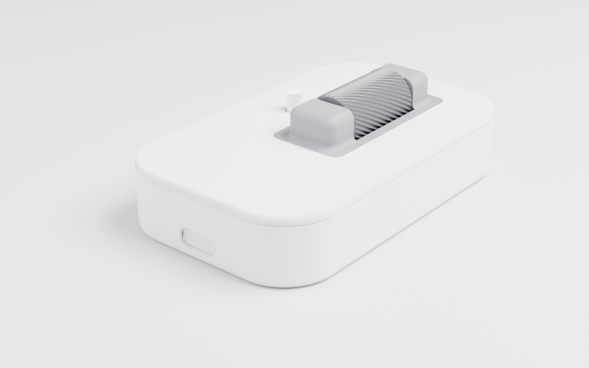
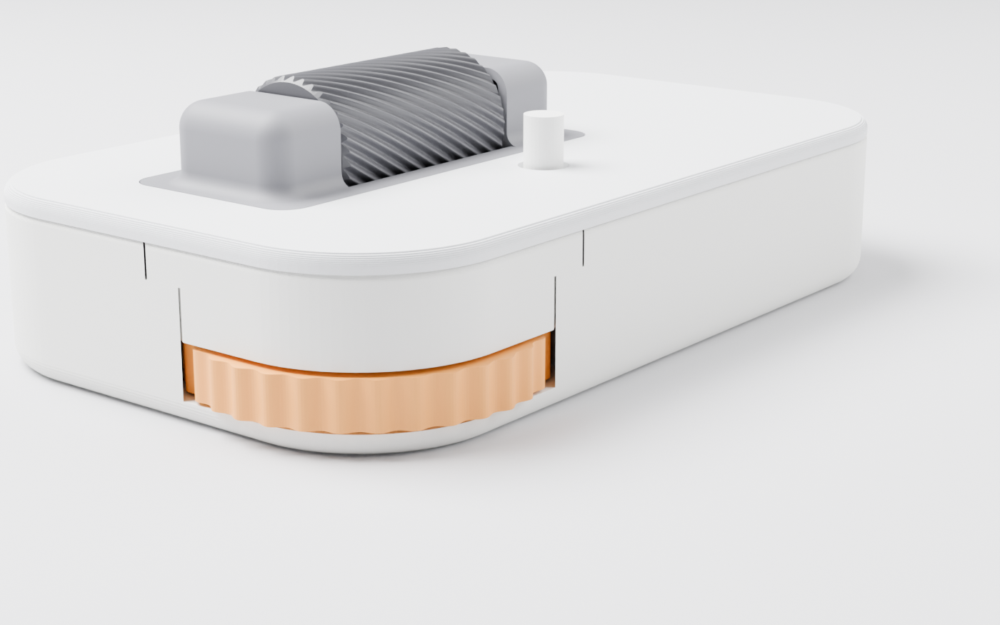

# エンコーダーの検証基板

右半分の基板から、2 つのエンコーダーがある右上の角だけを切り出した小さな基板です。キーボード全体を作る前に、2 つのエンコーダーの機構と信号を確かめます。1 つはサムホイール（角から出る横向きのホイール、Alps EC05E1220401）、もう 1 つはドラム式ダイヤル（上面のローラー、Alps EC10E1220505）です。マイコンには Waveshare の RP2040-Zero を使い、基板の裏に差し込みます。USB ケーブルは、ケースの左の壁の開口から横に挿します。ケースはすべて 3D プリントで作ります。





## キーボードと同じところ、違うところ

基板の座標は右半分の基板のものをそのまま使います。2 つのエンコーダー、ドラムの軸受けブロックの穴、ホイールの中心は、キーボードとまったく同じ位置に来ます。ケースは同じ生成スクリプト（`gen/make_case.py`）で作るので、壁の厚さ、基板とプレートの高さ、ホイールの開口と軸、プレートのドラムの穴もキーボードと同じです。

印刷する部品のうち、ホイール、ホイールの上の壁（キャップ）、ドラム、軸受けブロック、ベゼルは、キーボードの STL（`case/print/right-*.stl`）をそのまま使います。生成スクリプトは、これらの部品が検証用のケースにキーボードと同じ形、同じ位置に収まることを確かめます。ホイールやドラムの周りのトレイとプレートの形は、生成のたびにキーボードのものと比べます。検証用に新しく作るのは、トレイとプレートだけです。

キーボードと違うのは次の点です。

- **外形**：右上の角はキーボードと同じですが、左端は F12 の列の外側、下端は上段のキーのすぐ下で終わります。ケースはこの外形を壁で囲みます。
- **F12 のキー**：キーを置かないので、プレートの F12 のスイッチの穴はふさぎます。
- **マイコン**：RP2040-Zero を、部品の面を下に向けて基板の裏に付けます（次の章）。USB-C はキーボードの USB-C と同じ方式で左の壁に出します。基板の舌を壁の中まで伸ばし、USB-C の口を壁の外面から 0.8 mm 内側に置き、その前の壁に開口を開けます。
- **タクトスイッチ**：ドラムと奥の壁の間の帯に、高さ 9.5 mm のタクトスイッチを置きます。押し棒はプレートの丸穴（直径 4.5 mm）から 4.5 mm 出ます。タクトスイッチは、押している間だけレイヤー 1 にするためのものです。
- **ピンの割り当て**：RP2040-Zero のピン列に出ている GPIO は GP0〜GP8、GP14、GP15、GP26〜GP29 だけです。そこで、エンコーダーとスイッチはキーボードと違うピンにつなぎます（下の表）。
- **M2 の取付穴**：キーボードと同じ穴はドラムの右下の 1 つだけで、残りの 3 つは検証基板のために足したものです。

| 信号 | 検証基板 | キーボード |
| --- | --- | --- |
| タクトスイッチ（レイヤー 1） | GP4 | なし |
| サムホイールの A 相 | GP5 | GP19 |
| サムホイールの B 相 | GP6 | GP20 |
| ドラムの A 相 | GP7 | GP22 |
| ドラムの B 相 | GP8 | GP23 |
| エンコーダーの共通端子、タクトスイッチ | GND | GND |

プルアップは RP2040 の内蔵抵抗を使うので、基板に抵抗はありません。

## RP2040-Zero の取り付け

基板の裏とトレイの床の間は 7.0 mm で、キーボードと同じです。サムホイールは床に載り、そのエンコーダーは基板の裏に付くので、この間隔を変えるとサムホイールの検証がキーボードと合わなくなります。この 7.0 mm に RP2040-Zero を収めるため、ピンソケットではなく、マックエイトのコンスルー XB-3-2 で差し込みます。コンスルーは 2 枚の基板を重ねる接続部品で、一方の基板に半田付けし、もう一方の基板の穴にはバネの接点で差し込みます。XB-3-2 は 2 枚の基板の間隔が 2 mm になる品です。

コンスルーは RP2040-Zero の側に半田付けし、検証基板の側は差し込みにします。検証基板の穴は、コンスルーの仕様に合わせて仕上がり径 0.85 mm にしてあります。コンスルーの仕様では、差し込む側の穴が銅のむき出しだと使えません。基板の表面処理は HASL（はんだめっき）か ENIG（金めっき）にします。

高さは次のとおりです。RP2040-Zero の寸法は、Waveshare の寸法図と 3D モデルから取りました。

| 部分 | 床の上面からの高さ |
| --- | --- |
| 検証基板の裏 | 7.0 mm |
| RP2040-Zero の裏（コンスルーの樹脂の下） | 5.0 mm |
| RP2040-Zero の部品の面（基板の厚さ 1.1 mm） | 3.9 mm |
| BOOT と RESET のボタンの下端 | 1.4 mm |
| USB-C の下端（もっとも低いところ） | 0.66 mm |

RP2040-Zero の裏の部品は高さ 1.0 mm で、コンスルーの 2 mm の間に収まります。生成スクリプトは、RP2040-Zero、USB-C、コンスルーの樹脂がトレイとプレートから 0.2 mm 以上離れていることを確かめます。

RP2040-Zero は長辺の 2 列（9 ピン × 2、間隔 15.24 mm）だけを使います。USB-C と反対の短辺にある 5 つのパッド（GP9〜GP13）は、2 列の格子から外れているので使いません。

1. コンスルーを 9 ピンに切ります。12 ピンの品（スイッチサイエンスの「背の低いコンスルー 12ピン」）なら 2 本から 3 ピンずつ切り落とします。
2. 検証基板を裏を上にして置き、2 本のコンスルーの差し込み側を裏から穴に差します。その上に RP2040-Zero を、部品の面を上にし、USB-C を舌の先端に向けて載せます。RP2040-Zero の長辺の穴にコンスルーの半田付け側が通ります。向きは、基板の裏のシルク印刷の外形と「USB ->」の矢印に合わせます。
3. この状態のまま RP2040-Zero の上から半田付けします。検証基板の穴を位置決めに使うので、2 列の間隔がずれません。
4. RP2040-Zero を検証基板から抜き、ファームウェアを書き込みます（次の章）。
5. RP2040-Zero を手順 2 と同じ向きで差し込み直します。検証基板を表に返すと、RP2040-Zero は部品の面を下にしてぶら下がります。逆向きに差すと電源と GPIO がずれるので、USB-C が舌の先端を向いていることを確かめます。

コンスルーの抜き差しは、同じ穴で 50 回までです。

## 部品

| 部品 | 数 | 備考 |
| --- | --- | --- |
| 基板 | 1 | `fab/enctest/nrsk-enctest-gerber.zip` を JLCPCB などに発注する（2 層、1.6 mm、表面処理は HASL か ENIG）。JLCPCB の部品実装を頼むときは、`nrsk-enctest-jlc-bom.csv` と `nrsk-enctest-jlc-cpl.csv` も渡す（下の 3 部品をすべて載せる） |
| Waveshare RP2040-Zero | 1 | スイッチサイエンスの商品番号 7886 |
| マックエイト コンスルー XB-3-2（2.54 mm、高さ 2 mm） | 9 ピン × 2 | スイッチサイエンスの「背の低いコンスルー 12ピン」（商品番号 3763）2 本を 9 ピンに切る |
| Alps EC05E1220401 | 1 | LCSC C116648。基板の裏に表面実装する |
| Alps EC10E1220505 | 1 | LCSC C160888。基板の表に挿入実装する |
| タクトスイッチ 6 × 6 mm、高さ 9.5 mm、挿入実装 | 1 | Omron B3F-1072（LCSC C87121）。足の間隔 6.5 × 4.5 mm。高さ 8 mm 以上なら押し棒がプレートから出る |
| M2 × 6 mm タッピングネジ | 4 | 基板をトレイのボスに留める |
| M2 × 12 mm なべネジ | 5 | トレイの底から壁を通して、プレートのインサートへ |
| M2 ヒートセットインサート（外径 3.2 mm、長さ 3 mm） | 5 | プレートの裏のボスに入れる |
| ゴム足（高さ 3 mm 以上） | 4 | キーボードと同じ。厚いプラグでも机に当たらないよう、ケースを浮かせる |

USB-C の中心は、ケースの底から約 4.7 mm の高さにあります。高さ約 7 mm のプラグなら、下端はケースの底から約 1.2 mm 上に来ます。これより厚いプラグでも机に当たらないよう、ゴム足でケースを浮かせます。

印刷する部品は次のとおりです。

| 部品 | ファイル | 備考 |
| --- | --- | --- |
| トレイ | `enctest/case/print/enctest-tray.stl` | 検証用 |
| プレート | `enctest/case/print/enctest-plate.stl` | 検証用。上面をベッドに付けて印刷する |
| ホイール | `case/print/right-wheel.stl` | キーボードと共通 |
| ホイールのキャップ | `case/print/right-wheel-cap.stl` | キーボードと共通 |
| ドラム | `case/print/right-drum.stl` | キーボードと共通。光造形で注文する |
| 軸受けブロック | `case/print/right-drum-block.stl` | キーボードと共通 |
| ベゼル | `case/print/right-drum-bezel.stl` | キーボードと共通 |

プレートはキーボードの 3D プリント版 B と同じ作りで、裏に補強の板とネジのボスが付きます。補強の板は、基板の表へ抜けたコンスルーの先端を避けてあります。RP2040-Zero と基板の舌が通るところでは、トレイの左の壁の上が開いています。そのため基板は、キーボードと違って横へ滑らせる必要がなく、上から下ろせます。開いたところはプレートがふさぎます。

六角ピンの寸法を決める試し印刷（`case/print/pin-coupon.stl`）は、検証基板を組む前に済ませておくと、ホイールとドラムを印刷し直す回数が減ります。手順は [サムホイールと OLED の実機確認](thumbwheel-check.md) の 1 章にあります。

## ファームウェア

`firmware/qmk/keyboards/nrsk_enctest/` は、検証基板用の QMK のキーボード定義です。エンコーダーの設定（A 相と B 相の順と `resolution`）とキーの割り当ては、キーボードの右半分と同じにしてあります。違うのはピンの番号だけです。

```bash
firmware/qmk/compile.sh default nrsk_enctest
```

最初の書き込みは、RP2040-Zero を検証基板へ付ける前に済ませます。取り付けたあとは RP2040-Zero の BOOT ボタンが床の側を向き、押せなくなるからです。BOOT ボタンを押しながら USB をつなぎ、出てきた RPI-RP2 ドライブへ `.uf2` をコピーします。ファイルは `firmware/qmk/build/nrsk_enctest_default.uf2` です。2 回目からは、検証基板のタクトスイッチを押したまま USB をつなぐと、書き込みのモードになります（QMK の bootmagic）。

| 操作 | レイヤー 0 | レイヤー 1（タクトスイッチを押している間） |
| --- | --- | --- |
| サムホイールを上から見て時計回り | Page Down | → |
| サムホイールを反時計回り | Page Up | ← |
| ドラムを奥へ転がす | 上へスクロール | 右へスクロール |
| ドラムを手前へ転がす | 下へスクロール | 左へスクロール |

## 組み立て

JLCPCB の部品実装で 3 つの部品を載せた場合は、手順 1 と 2 を飛ばします。

1. 基板の裏に EC05E1220401 を半田付けします。2 つの位置決め穴に本体の突起を合わせ、側面の金具のランド 2 つと端子 3 つを付けます。
2. 表に EC10E1220505 とタクトスイッチを挿して、裏から半田付けします。足は裏で短く切ります。
3. RP2040-Zero にコンスルーを付けて書き込み、基板の裏に差し込みます（上の「RP2040-Zero の取り付け」）。
4. トレイの床の軸にホイールを差します。
5. 基板を、舌と RP2040-Zero を左の壁の開いたところに合わせて、上からボスの上に下ろします。ホイールの六角ピンがエンコーダーの穴に入らないときは、ホイールの縁を指で少し回して向きを合わせます。USB-C の口が壁の開口に来ていることを確かめ、基板を 4 本のタッピングネジで留めます。
6. ホイールのキャップを、ホイールの開口の上の段に載せます。
7. 軸受けブロックの位置決めピンを基板の穴に差し込み、ドラムを傾けて六角ピンを EC10E の穴に差してから、丸ピンの側をブロックの溝に押し込みます。
8. プレートの裏のボスにヒートセットインサートを入れておきます。ベゼルを基板の上に置き、上からプレートをかぶせて、トレイの底から 5 本のネジで留めます。
9. トレイの底にゴム足を貼ります。

## 確かめること

サムホイールは [サムホイールと OLED の実機確認](thumbwheel-check.md) の 1 章から 4 章、ドラムは [ドラム式ダイヤルの仕様書](specs/drum-dial.md) の作業手順のステップ 9 の項目を、この基板で確かめます。キーボードと違って USB は 1 本だけなので、左右をつなぎ替える確認（USB をつないでいない側のホイールが効くか）はできません。

確認の結果で六角ピンの寸法（`gen/make_case.py` の `PIN_AF`）を直すと、キーボードの部品にもそのまま反映されます。QMK の `pin_a` と `pin_b` を直した場合は、キーボードの設定（`gen/make_qmk.py`）にも同じ変更を入れます。検証基板のファームウェアの設定は、手で書いたものなので自動では追従しません。

## 生成

```bash
./gen/build_enctest.sh
```

次のものをまとめて作ります：回路図、基板、自動配線、ERC と DRC、製造用のファイル（`fab/enctest/`）、ケースの部品（`enctest/case/`）。基板とケースは右半分の `right/case_data.json` から位置を読むので、右半分の基板を作り直したときは先に `./build.sh right` を実行します。組み立てた状態の画像は `blender -b -P gen/render_enctest.py` で作り直せます。
