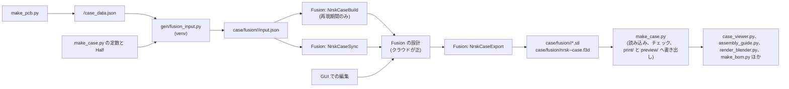

# 3D プリント部品の設計の Fusion への移行

> ステータス: 実装完了
> 対象: 新規の `fusion/`、新規の `gen/fusion_input.py`、新規の `gen/fusion_diff.py`、`gen/make_case.py`、`gen/make_enctest.py`、`case/fusion/`、`build.sh`、`README.md`
> 関連: [README の筐体の節](../../README.md#筐体)、[ゴム足のくぼみとチルト台座](case-feet-tilt.md)

キーボードの 3D プリント部品の形状の正を、`gen/make_case.py` のコードから Autodesk Fusion（以下 Fusion）の履歴付きの設計に移す。対象はトレイ、プリントのプレート、ホイール、ホイールのキャップ、チルト台座 3 種、ドラムダイヤル一式である。最初の Fusion の設計は、今のコードと同じ形をスクリプトで組み立てて作り、形が一致することを機械的に確かめてから GUI での編集に切り替える。基板（PCB）の寸法は従来どおり `case_data.json` から流し込み、STL の書き出し先と干渉チェックは今のまま残す。

## 1. なにをつくるのか

### 完成後の振る舞い

- **Fusion の設計**：左右で 1 つずつ、`nrsk-left-case` と `nrsk-right-case` の 2 つの設計がある。設計の種類は Hybrid Design にする。Fusion の Part Design は 1 つの設計に 1 つのコンポーネントしか持てない。設計の中は部品ごとのコンポーネントに分かれ、各部品は履歴（タイムライン）を持つ。寸法はユーザーパラメータ（`FLOOR`、`WALL`、`STANDOFF` など、`make_case.py` の定数と同じ名前）として設計の中に並び、GUI で値を変えると形が追従する。右の設計にだけドラムダイヤルの 3 部品がある。
- **形の編集**：開発者は Fusion の GUI でフィレットの形や曲面、見た目の細部を直接編集する。正は Fusion のクラウド上の設計で、節目ごとに `.f3d` を書き出してリポジトリにコミットする。
- **基板の変更への追従**：`case_data.json` が変わったら、`gen/fusion_input.py` で Fusion 向けの入力を作り直し、Fusion で同期スクリプトを実行する。同期スクリプトが自動で追従させるのは 2 種類である。1 つ目は `make_case.py` の定数（ユーザーパラメータ）の値で、2 つ目はネジ、基板の穴、ゴム足、キー、ドラムのピン、リセットの穴の位置である。位置は、組み立てのときに各要素の id を付けたスケッチの曲線を動かして変える。要素の増減や、外形、ポート、OLED のカバー、ホイール、台座の切り方、ドラムダイヤルの位置の変更は自動では追えない。そのときは何も変えずに違いを報告して止まり、開発者が GUI で直す。
- **書き出し**：Fusion の書き出しスクリプトが、各部品の STL を `case/fusion/<side>/` に書き出す。`gen/make_case.py` はその STL を読み込み、今と同じ干渉チェックを通す。そのうえで、今と同じ `case/print/` と `case/preview/` の STL と `case_report.json` を書き出す。ビューア、組み立てガイド、レンダー、BOM は今のまま動く。
- **再現の検証**：移行の途中では、`gen/fusion_diff.py` が Fusion の STL と今のコードの形を部品ごとに比べ、体積の差と外接箱のずれを表にして出す。全部品が閾値に収まったら GUI での編集に切り替える。
- **Fusion の操作**：Fusion の起動、スクリプトの実行、結果の確認は、Claude が画面操作（computer use）で行う。開発者が手で実行してもよい。

### やらないこと

- **アクリル版の移行**：レーザーカットのアクリル版（`case/laser/` の DXF と SVG）は 2D の板で、コードで作っても困っていない。今のコードのまま残す。アクリル版のプレートの 3D（`plate3d()`）とプレビュー用の OLED カバーも同様である。
- **検証基板（enctest）のケースの移行**：検証基板のトレイとプレートは、今のコード（`tray()`、`plate3d_printed()`）で作り続ける。キーボードのトレイを GUI で直しても、検証基板のトレイには反映されない。検証基板のトレイは試験用で、見た目をキーボードとそろえる必要はないため、この差は許容する。ホイールとドラムは検証基板もキーボードの Fusion の STL を使い、部品の互換は保つ。
- **パラメータの正の移動**：寸法の定数は `make_case.py` に残し、Fusion には同期で流し込む。Fusion で寸法の値を変えた場合は、`make_case.py` の定数も手で直す（[3 章の「パラメータの持ち方」](#パラメータの持ち方)）。パラメータの正を Fusion に置かないのは、干渉チェックと 10 本を超える下流のスクリプトが定数を import しているからである。
- **build.sh からの Fusion の自動実行**：Fusion にはコマンドラインからスクリプトを実行する公式の手段がない。`build.sh` は Fusion の STL がリポジトリにある前提で動き、Fusion の実行は手順として別に行う。
- **比較検討用スクリプトの移行**：台座、ポート、OLED の比較に使った 5 本のスクリプトは移行しない。対象は `tilt_variants.py`、`tilt_stands.py`、`port_variants.py`、`port_slide.py`、`oled_variants.py` である。これらは全周の台座（`stand(ring=True)`）のように、Fusion に作らない形を使う。移行後に動かなくなるスクリプトは、移行前のコミットで動かす（[5 章のステップ 10](#5-作業手順)）。

## 2. なぜつくるのか

今の筐体は、`gen/make_case.py`（約 1,200 行）が manifold3d のブーリアン演算で組み立てている。形の細部は数値とコードでしか変えられない。たとえばトレイの底の丸め（`TRAY_FILLET`）は本物のフィレットではなく、オフセットした断面を 8 段重ねて近似している（`gen/make_case.py:629`）。台座の上の縁も同じ近似である（`gen/make_case.py:471`）。曲面の形を変えたいとき、開発者は形を思い浮かべながら段の数と式を書き換え、生成し、ビューアで確かめる往復を繰り返している。

この往復は、形の微調整ほど重い。フィレットの半径を 1 か所だけ変える、角の曲面をなめらかにつなぐ、といった操作は CAD の GUI なら数秒で済む。コードでは、その面がどのブーリアン演算のどこで生まれたかをたどるところから始まる。ドラムダイヤルのベゼルのフードのように形が込み入った部品では、たどる作業だけで変更より時間がかかる。放置すると、見た目の改善は「コードで書きやすい形」に限られ続ける。

一方で、今の仕組みには手放したくない性質が 2 つある。1 つ目は、基板を作り直すと筐体が自動で追従することである。基板の外形、穴、コネクタの位置は `case_data.json` から入り、ネジとゴム足の位置は `Half` が探索して決める（`gen/make_case.py:427`）。2 つ目は、干渉チェック（`check_*`）が形を作るたびに走ることである。ホイールとエンコーダー、ドラムのベゼルとキーキャップ、ポートのトンネルの天井の厚みなど、40 を超える assert が組み立ての不具合を止めている。

したがって、移行は「形の正を Fusion に移す」が「基板からの寸法の流れと干渉チェックは Python に残す」形にする。Fusion の役目は 3D の形を作ることに限り、何を作るべきかの寸法と、作った形が正しいかの検査は今の Python が受け持つ。

## 3. どう実現するか

### 全体の流れ

Python 側と Fusion 側の受け渡しは 2 種類のファイルだけにする。Python から Fusion へは `case/fusion/<side>/input.json`、Fusion から Python へは `case/fusion/<side>/*.stl` を渡す。Fusion の組み込みの Python には manifold3d が入っておらず、`make_case.py` を import できないためである。

### Fusion への入力（`gen/fusion_input.py`）

venv の Python で動く新しいスクリプトで、`Half(side)` を作り、Fusion が形を作るのに必要な寸法をすべて JSON に書き出す。Fusion 側で `Half` の探索や計算をやり直さないよう、派生した値（探索の結果を含む）を書き出す。

| キー | 型 | 中身 | 出どころ |
|---|---|---|---|
| `version` | int | 入力の形式の版。Fusion 側のスクリプトと食い違ったら止める | 固定値 |
| `params` | dict[str, float] | `FLOOR`、`WALL`、`STANDOFF`、`TRAY_FILLET` など、形に効く定数すべて | `make_case.py` の定数 |
| `pcb` | {x0, y0, x1, y1, r} | 基板の外形（角丸の長方形） | `Half.pcb` |
| `outer_box` | {x0, y0, x1, y1, r} | 筐体の外形 | `Half.outer_box` |
| `screws` | [{id, x, y}] | 筐体のネジの位置 | `Half.screws` |
| `pcb_holes` | [{id, x, y}] | 基板の取り付け穴（ボス） | `case_data.json` の `holes` |
| `keys` | [{id, cx, cy, w, h, rot}] | スイッチの穴 | `case_data.json` の `keys` |
| `slots` | [{id, name, ...}] | USB-C のポートのトンネルと開口 | `Half.slots` |
| `feet` | [{id, x, y}] | ゴム足のくぼみの位置（探索の結果） | `Half.feet()` |
| `stand` | {front_y, y_cut, poses: {deg: 4×4}} | 台座の切り方と、角度ごとの姿勢 | `Half.front_y()`、`stand_pose()` |
| `oled` | {window, cover} | OLED の窓とカバーの外形 | `Half.window_box`、`Half.cover_shape()` |
| `wheel` | {x, y, ...} | ホイールの中心と開口 | `Half.wheel_xy()`、`Half.wheel_cut()` |
| `drum` | {...} | ドラムダイヤルの位置と寸法（右のみ） | `case_data.json` の `drum`、`Half._block_x()` ほか |

`id` は各要素の安定な名前（`screw/0`、`key/SW12` など）で、同期スクリプトがスケッチの要素と突き合わせるのに使う。座標系は `make_case.py` の造形の座標系（単位 mm、z が上、基板の y を反転した値）にそろえる。Fusion の API は内部の長さの単位が cm なので、Fusion 側のスクリプトで 0.1 倍する。

### Fusion 側のスクリプト（`fusion/`）

リポジトリの `fusion/` に、Fusion のスクリプトを置く。`fusion/link.sh` が各スクリプトのフォルダを Fusion のデフォルトのスクリプトフォルダへシンボリックリンクし、Fusion の「スクリプトとアドイン」の一覧に載せる。スクリプトはリンクを解決してリポジトリの位置を求める。3 本に分けるのは、再現期間の後に組み立てを誤って実行し、GUI の編集を上書きする事故を防ぐためである。

| スクリプト | 役目 | 実行してよい時期 |
|---|---|---|
| `fusion/NrskCaseBuild/` | 空の設計に、全部品のパラメータ、スケッチ、フィーチャーを組み立て、使った入力を設計の属性に保存する | 再現期間のみ。設計に属性 `nrsk.phase = edit` が付いていたら何もせず止まる |
| `fusion/NrskCaseSync/` | `input.json` を、設計に保存した前回の入力と比べ、変わったユーザーパラメータの値を書き換え、id の付いたスケッチの曲線を動かし、設計を計算し直す。要素の増減や自動で追えない変更があれば、何も変えずに違いを報告して止まる | いつでも |
| `fusion/NrskCaseExport/` | 各部品を STL（精細度は高）で `case/fusion/<side>/` に書き出し、設計を `case/fusion/nrsk-<side>-case.f3d` に書き出す | いつでも |
| `fusion/NrskCaseFreeze/` | 設計に属性 `nrsk.phase = edit` を付けて保存し、編集期間に切り替える | 再現期間の終わりに 1 度 |

3 本は共通の処理（`input.json` の読み込み、cm への換算、属性の扱い）を `fusion/common/nrsk_fusion.py` から読む。点の要素を描くスケッチの曲線には Fusion の属性（`nrsk.id`）で `input.json` の `id` を付け、同期スクリプトはこの属性で曲線を探す。寸法が `make_case.py` の定数 1 つで決まる押し出しの距離と円の直径は、ユーザーパラメータの式（`BOSS_D`、`BOSS_D + 2 mm` など）で与える。

### 部品と書き出す STL

Fusion は、今の `Half` のメソッドが返す形と同じ座標系で、部品を書き出す。こうしておくと、`make_case.py` は読み込んだ形を今のメソッドの戻り値と差し替えるだけで済み、印刷の向きへの変換やプレビューの配置は今のコードをそのまま使える。

| 部品 | Fusion のコンポーネント | 書き出す STL | 差し替える `Half` のメソッド |
|---|---|---|---|
| トレイ | `tray` | `tray.stl` | `tray()` |
| プリントのプレート | `plate` | `plate.stl` | `plate3d_printed()` |
| ホイール | `wheel` | `wheel.stl` | `wheel3d()` |
| ホイールのキャップ | `wheel-cap` | `wheel-cap.stl` | `wheel_cap()` |
| 台座（3°、6°、9°） | `stand-3` ほか | `stand-3.stl` ほか（トレイの下の、傾ける前の姿勢） | `stand(deg)` の 1 つ目の戻り値 |
| ドラム（右のみ） | `drum` | `drum.stl`（基板の上面が z = 0） | `drum3d()` |
| 軸受けブロック（右のみ） | `drum-block` | `drum-block.stl` | `drum_block3d()` |
| ベゼル（右のみ） | `drum-bezel` | `drum-bezel.stl` | `drum_bezel3d()` |

### `make_case.py` の変更

`Half` に形の出どころを表す属性 `source` を足す。`side` が `left` か `right` なら `fusion`、それ以外（検証基板）なら `code` とする。環境変数 `NRSK_CASE_SOURCE=code` を与えると、キーボードでも今のコードで作る（再現の比較と、移行前の形の確認に使う）。

`source` が `fusion` のとき、上の表のメソッドは `case/fusion/<side>/<part>.stl` を読み込み、頂点を溶接して `Manifold` にして返す。Fusion のメッシュは曲面を細かく分割する（トレイで 20 万面）ため、読み込むときに 0.005 mm の範囲で間引く（体積の変化は 0.02％）。ドラム一式は間引かない。ベゼルのフードがブロックに接していて、間引くと `check_drum()` が食い込みとして検出するためである。STL がない、または `Manifold` の状態が `NoError` でないときは例外で止める。読み込みは `Half` の中でキャッシュする。`stand(deg, ring=True)` と `lift` を与えた呼び出しは Fusion に対応する形がないので、`source` が `fusion` なら例外で止める。

この差し替えで、次の処理は Fusion の形に対して今のまま動く。

- `check_wheel()`、`check_drum()`、`check_tilt()` などの干渉チェック
- `write_half()` による `case/print/` と `case/preview/` の書き出しと、`case_report.json`
- `case_viewer.py`、`case_section.py`、`assembly_guide.py` のように `Half` のメソッドを直接呼ぶ下流

### `make_enctest.py` の変更

検証基板の `Half` は `source` が `code` になり、トレイとプレートは今のコードで作られる。ホイールとドラムは、検証基板の `Half` で作らず、キーボードの `Half`（`ref`）の Fusion の形を使う。キーボードと同じ形であることを確かめる assert（`gen/make_enctest.py:369`）は、同じ形を使うので自明に成り立つため削除する。

### 再現の検証（`gen/fusion_diff.py`）

`Half(side)` を `source=code` と `source=fusion` の 2 通りに作り、部品ごとに次の値を出す。

| 列 | 意味 |
|---|---|
| `vol_code`、`vol_fusion` | 体積（mm³） |
| `sym_diff` | 対称差の体積 `(a - b).volume() + (b - a).volume()`（mm³） |
| `ratio` | `sym_diff / vol_code` |
| `bbox_dz` | 外接箱の 6 つの座標のずれの最大値（mm） |

合格の閾値は、`ratio` が 0.5％以下、`bbox_dz` が 0.05 mm 以下を出発点とする。今のコードの円は 96 分割（`gen/make_case.py:29`）、底の丸めは 8 段の近似なので、正確なフィレットと円を持つ Fusion の形とは、その近似の分だけ必ず差が出る。ステップ 3 で最初の部品のホイールを比べたところ、`ratio` は 0.056％、`bbox_dz` は 0 mm だった。差は今のコードの近似（歯の形の折れ線、48 角形の穴、24 角形のピンの円錐）から来ており、閾値の 9 分の 1 に収まる。そのため閾値は出発点のまま据え置き、フィレットの近似が大きいトレイと台座でもう一度確かめる。閾値を超えた部品は、差の大きい場所がわかるよう、対称差の STL を `case/fusion/<side>/diff/` に書き出す。

### パラメータの持ち方

寸法の定数の正は `make_case.py` に置く。Fusion の設計にも同名のユーザーパラメータを持たせ、同期スクリプトが `input.json` の `params` で上書きする。GUI で寸法を試すときは Fusion のユーザーパラメータを直接変えてよいが、決めた値は `make_case.py` に書き戻す。書き戻さないと、次の同期で Fusion の値が元に戻り、干渉チェックも古い値で走る。

GUI で足したフィーチャー（新しいフィレットの半径など）に固有の寸法は、`make_case.py` に対応する定数がないので、Fusion の設計の中にだけ置く。同期スクリプトは `input.json` にないユーザーパラメータには触れない。

### 再現期間と編集期間

移行は 2 つの期間に分かれる。

- **再現期間**：`NrskCaseBuild` を何度でも実行してよい期間である。設計を作り直すたびに `fusion_diff.py` で比べ、全部品が閾値に収まるまで組み立てスクリプトを直す。GUI での編集はしない。
- **編集期間**：全部品が閾値に収まった時点から始まる期間である。設計に属性 `nrsk.phase = edit` を付け、組み立てスクリプトを封じる。以後は同期と書き出しだけを使い、形は GUI で直す。

編集期間に入った時点で、`source=code` のキーボードの形は比較の役目を終える。ホイール、キャップ、台座、ドラム一式の生成コードは検証基板も使わなくなるので、削除する。トレイとプリントのプレートの生成コードは検証基板が使い続けるので残す。

### 画面操作での Fusion の実行

Claude は computer use で Fusion を操作する。スクリプトは「ユーティリティ」タブの「スクリプトとアドイン」から実行する。Fusion のダイアログはバックグラウンドからのクリックと入力を受け付けないため、実行のたびに画面全体の操作の許可を開発者に求め、実行が済んだら手放す。各スクリプトは、結果（作った部品、同期した要素の数、書き出したファイル、エラー）を `case/fusion/<side>/<スクリプト名>.log` にも書く。Claude は画面の表示ではなく、ログと書き出されたファイルで成否を判断する。

## 4. 検討した代替案と、採らなかった理由

| 案 | 概要 | 採らなかった理由 |
|---|---|---|
| 骨格だけをスクリプトで作る | 参照スケッチ、パラメータ、トレイとプレートの基本の押し出しまでをスクリプトで作り、ポート、ボス、くぼみ、フィレットは GUI で足す | 速く始められるが、今の形との一致を機械的に確かめられない。開発者は今の形を一度に全部再現したいと判断した |
| 全部 GUI で作る | 参照スケッチだけをスクリプトで入れ、形はすべて手で作る | 自由度は最大だが、今の形にたどり着くまでに時間がかかり、一致の検証もできない |
| PCB の変更を手で合わせる | 一度取り込んだら、基板が変わったときに GUI で直す | 仕組みは最小だが、基板とのずれに気づきにくい。基板はまだ作り直しが続いている |
| KiCad の PCB の STEP を参照する | `export_3d.py` の基板の 3D を Fusion に挿入し、その形を参照する | 干渉は目で見えるが、基板を差し替えると参照が切れやすい。ネジやゴム足の位置のように `Half` が探索で決める値は、基板の 3D には入っていない |
| 下流を Fusion の出力形式に作り直す | ビューアやレンダーを STEP などに合わせる | 下流は 10 本を超え、作業量が大きい。STL を今と同じ座標系で書き出せば、下流は変えずに済む |
| 1 つの設計に左右を置く | 左右を 1 つの Fusion の設計にまとめる | 一覧はしやすいが、タイムラインが長くなって重い。右にだけドラムダイヤルがある差も、別の設計のほうが扱いやすい |
| 部品ごとに設計を分ける | トレイ、ホイール、台座、ドラムを別の設計にして組み立てで参照する | 1 つの設計は軽いが、設計間の参照の管理が増える。部品数が今の 2 倍を超えるなら再検討する |
| パラメータの正を Fusion に移す | 定数を Fusion のユーザーパラメータだけに置き、Python は Fusion から読む | 干渉チェックと 10 本を超える下流が `make_case.py` の定数を import しており、すべてが Fusion の書き出しに依存することになる |
| 生成コードを並行して保つ | 編集期間に入っても、Fusion とコードのどちらでも作れるようにする | GUI で直した形とコードの形が食い違い続け、どちらが正かわからなくなる |
| 検証基板のケースも Fusion に移す | 3 つ目の Fusion の設計を作る | 生成コードを全部消せるが、試験用の基板のために作業が増える |
| Fusion の実行を開発者に任せる | スクリプトは開発者が手で実行する | 確実だが、再現期間の反復が開発者の手待ちになる。開発者は Claude の画面操作で反復を速めることを選んだ |

## 5. 作業手順

| # | やること | 触るファイル | 完了条件 | 前提 | 状態 |
|---|---|---|---|---|---|
| 1 | Fusion をインストールしてサインインし、`fusion/` のフォルダを「スクリプトとアドイン」に登録する。Claude が computer use で Fusion を操作できることを確かめる | なし | 空のスクリプトを画面操作で実行し、ログファイルが書き出される | — | 済 |
| 2 | `gen/fusion_input.py` を作り、`input.json` を左右で書き出す | `gen/fusion_input.py`、`case/fusion/<side>/input.json` | 3 章の表のキーがすべてあり、`id` が重複しない。`Half` の値と一致することを確かめるテストが通る | — | 済 |
| 3 | `make_case.py` に `source` と STL の読み込みを足し、`gen/fusion_diff.py` を作る。最初の部品としてホイールを `NrskCaseBuild` で作って書き出し、比べる。近似の誤差を測って部品ごとの閾値を決める | `gen/make_case.py`、`gen/fusion_diff.py`、`fusion/common/`、`fusion/NrskCaseBuild/`、`fusion/NrskCaseExport/` | `NRSK_CASE_SOURCE=code` で今と同じ出力になる（`case/` の差分がない）。ホイールが閾値に収まり、閾値を仕様書に書き戻す | 1、2 | 済 |
| 4 | ホイールのキャップと台座 3 種を組み立てスクリプトに足す | `fusion/NrskCaseBuild/` | 左右の 4 部品が閾値に収まる | 3 | 済 |
| 5 | トレイを組み立てスクリプトに足す（壁、床、ボス、ポートのトンネル、ネジの座ぐりとナットのトラップ、ゴム足のくぼみ、ホイールの開口、OLED のカバーの下の段、底と上の縁のフィレット） | `fusion/NrskCaseBuild/` | 左右のトレイが閾値に収まる。`source=fusion` で `make_case.py` の干渉チェックが全部通る | 3 | 済 |
| 6 | プリントのプレートを組み立てスクリプトに足す | `fusion/NrskCaseBuild/` | 左右のプレートが閾値に収まり、干渉チェックが通る | 5 | 済 |
| 7 | ドラム、軸受けブロック、ベゼルを右の組み立てスクリプトに足す。ドラムのローレット（ねじれ角 30°、溝 36 本）はねじれのある掃引で作る | `fusion/NrskCaseBuild/` | 右の 3 部品が閾値に収まり、`check_drum()` が通る | 3 | 済 |
| 8 | `NrskCaseSync` を作る | `fusion/NrskCaseSync/`、`fusion/common/` | `input.json` のネジ 1 本の座標とパラメータ 1 つを変えて同期すると、Fusion の形が追従し、`fusion_diff.py` が `source=code` の同じ変更と閾値内で一致する。ネジを 1 本足した `input.json` では差分を報告して止まる | 4、5、6、7 | 済 |
| 9 | 編集期間に切り替える。`nrsk.phase = edit` を付け、`.f3d` と STL をコミットする。ホイール、キャップ、台座、ドラム一式の生成コードを削除し、`make_enctest.py` を 3 章のとおりに直す | `gen/make_case.py`、`gen/make_enctest.py`、`case/fusion/`、`case/print/`、`case/preview/` | `NrskCaseBuild` が止まる。`build.sh` の筐体の部分と `gen/build_enctest.sh` が通り、`case/print/` と `enctest/case/` の STL が手順 8 の時点から閾値内で変わらない | 8 | 済 |
| 10 | 比較検討用スクリプトの扱いを決めて片づける。動かなくなったものは削除し、移行前のコミットで動かす旨を README に書く | `gen/tilt_variants.py` ほか、`README.md` | 残ったスクリプトがすべて実行できる | 9 | 済 |
| 11 | ドキュメントを更新する。README の筐体の節とファイル構成に、Fusion の設計の場所、基板を変えたときの手順（`fusion_input.py`、同期、書き出し、`make_case.py`）、定数を書き戻す約束を書く | `README.md` | README の手順だけで、基板を変えた後の筐体の更新ができる | 9 | 済 |
| 12 | GUI での編集を 1 つ試す。トレイの底のフィレットの半径を Fusion で変え、書き出し、ビューアで確かめる | `case/fusion/`、`case/print/`、`case/preview/` | 変えた形がビューアに表示され、干渉チェックが通る | 11 | 済 |
